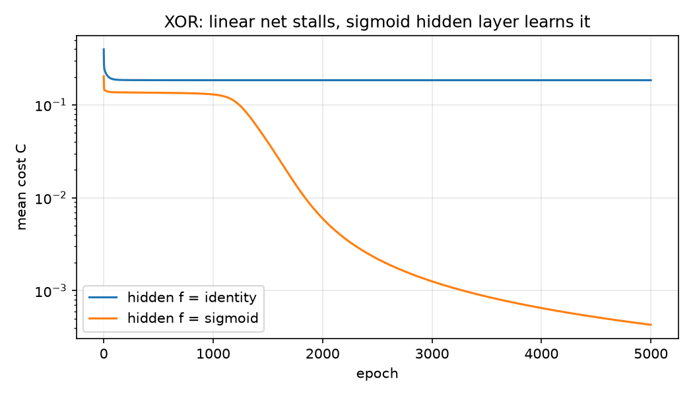

<div align="center">

# neural-network

A tiny neural network written from scratch in NumPy, with feedforward and backpropagation spelled out formula by formula.

[](https://www.python.org/) [](LICENSE)

</div>

<p align="center">
  
</p>
<p align="center"><sub>Same 2-3-1 network, same formulas: with a linear hidden layer it cannot learn XOR, with a sigmoid hidden layer it can.</sub></p>

## Highlights

- **Formulas as code**: `z1`, `a1`, `delta1`, `dC_dW1`, ... map one-to-one to the hand-derived math (chain rule, Hadamard product, `W2.T`).
- **Addition**: a 2-3-1 network without bias learns `x1 + x2` and extrapolates to `1000 + 1000 = 2000.000`.
- **XOR**: the same formulas solve a non-linear task once the hidden layer uses sigmoid.
- **Gradient check**: backprop is tested against a numerical central difference.
- **Memorise vs. learn**: held-out test data shows when the network only memorised its training set.
- **Keras comparison**: the same task in TensorFlow, where backprop happens out of sight.

## Installation

```bash
git clone https://github.com/n-stau/neural-network.git
cd neural-network
python3 -m venv venv
./venv/bin/pip install -r requirements.txt
```

## Quick start

```bash
./venv/bin/python addition_nn_numpy.py     # from scratch: learns addition
./venv/bin/python xor_nn.py                # XOR, identity vs. sigmoid, writes assets/xor_learning_curve.png
./venv/bin/python test_gradients.py        # backprop vs. numerical gradient
./venv/bin/python addition_nn_keras.py     # same task in Keras
./venv/bin/jupyter notebook addition_nn.ipynb
```

## How it works

```
2 inputs  ->  hidden layer, 3 neurons  ->  1 output neuron      (no bias)
x (2x1)       W1 (3x2), a1 = f(W1 x)       W2 (1x3), y_hat = W2 a1
cost:  C = 1/2 (y - y_hat)^2
```

| File | What it shows |
|---|---|
| `addition_nn_numpy.py` | Feedforward and backprop by hand, with the knobs at the top of the file |
| `xor_nn.py` | Reuses `forward` and `backward` on XOR to show what a non-linear hidden layer buys you |
| `test_gradients.py` | Gradient check for identity and sigmoid (plain `assert`, also runs under pytest) |
| `addition_nn.ipynb` | Step-by-step notebook: one forward pass, one backprop step, training loop, learning curve, Keras |
| `addition_nn_keras.py` | The same network in Keras |

The update rule is written as `W <- W + alpha * dC/dW` because `dC/da2` is taken as `(y - y_hat)`, so the minus sign of the derivative is folded in. That is identical to the usual `W <- W - alpha * grad`.

## Experiments

Change the knobs at the top of `addition_nn_numpy.py`:

| Knob | Try |
|---|---|
| `N_SAMPLES` | `1` makes the net memorise (train cost 0, test cost 0.137); `2` or more learns the rule |
| `EPOCHS` | Fewer epochs leave the cost high, because learning happens step by step |
| `ACTIVATION` | `"sigmoid"` instead of `"identity"`, which needs more epochs on addition |
| `HIDDEN_NEURONS` | Any `H`: `W1` becomes `Hx2`, `W2` becomes `1xH`, the formulas stay the same |
| `ALPHA`, `ALPHA_DECAY` | Too large a learning rate diverges to `NaN` |

## License

[MIT](LICENSE) © n-stau
